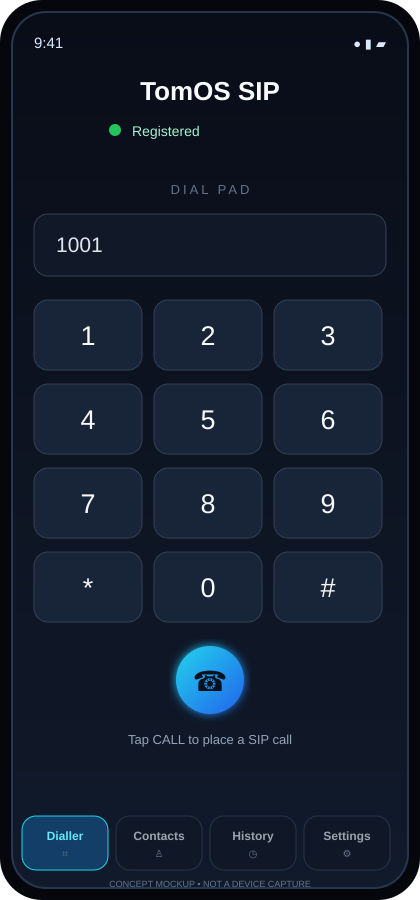
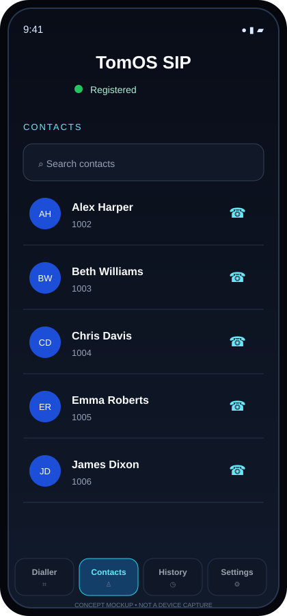
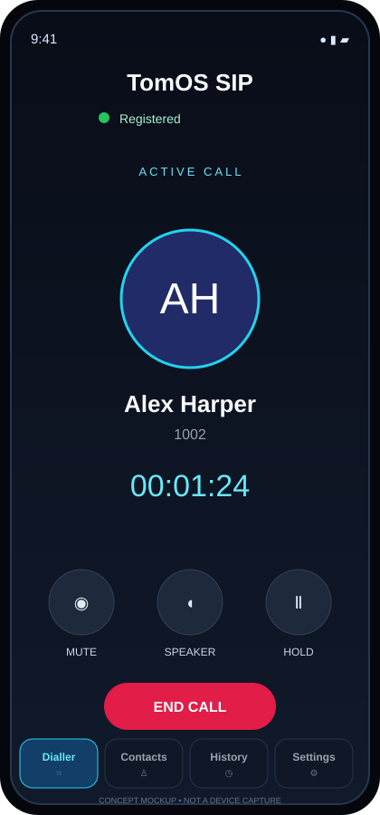
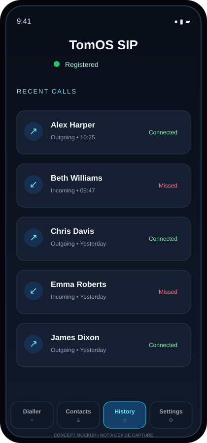
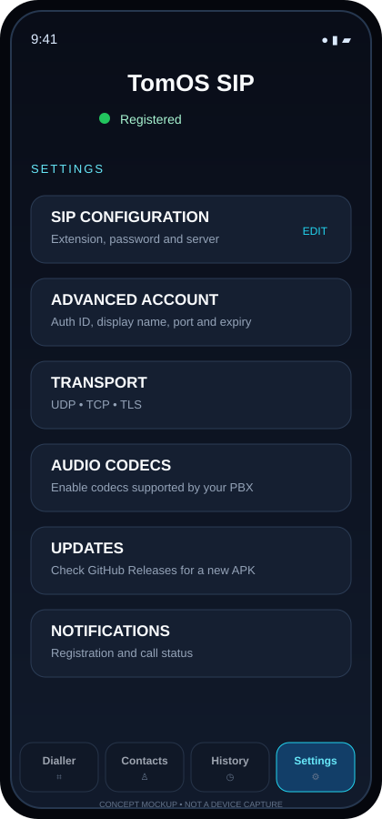

# TomOS SIP UI mockups

These illustrations are **conceptual UI mockups**, not screenshots captured from a running Android device. They are provided to help readers understand the app's main areas. Exact layout, icons, labels and behavior may differ from the installed build.

For verified behavior, use the [manual testing checklist](../TESTING_CHECKLIST.md).